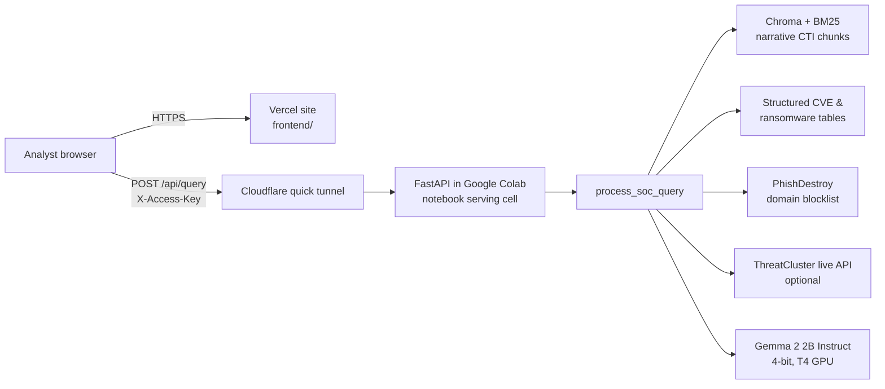

# CTI RAG Assistant v2.0

A refreshable, multi-source **Cyber Threat Intelligence (CTI) Retrieval-Augmented Generation assistant** for CTI research and preliminary phishing-email triage. Built for CP5403 Assessment 2 (Pathway A: RAG).

- **Base model (unchanged):** `google/gemma-2-2b-it`, 4-bit NF4 (bitsandbytes), greedy decoding
- **Retrieval:** ChromaDB semantic search + BM25 keyword search (hybrid), plus structured CVE / ransomware lookups and exact domain matching against a phishing blocklist
- **Embeddings:** `sentence-transformers/all-MiniLM-L6-v2`
- **Interfaces:** Gradio (inside the notebook) and a Vercel-hosted web front end

## Architecture



Vercel only hosts the static user interface. Gemma needs a CUDA GPU, so the model and retrieval pipeline run in Google Colab and are exposed through a temporary Cloudflare tunnel. The browser calls the Colab API directly; no Hugging Face or ThreatCluster key ever reaches the browser.

## Repository structure

| Path | Contents |
|---|---|
| `notebook/CTI_RAG_Assistant.ipynb` | Full pipeline: data loading, chunking, vector store, Gemma, prompts, evaluation, Gradio app, API serving cell |
| `frontend/` | Vite + React + TypeScript web interface deployed on Vercel |
| `evaluation/` | Question set and an end-to-end API evaluation script |
| `requirements.txt` | Python dependencies used by the notebook |
| `vercel.json` | Vercel build settings (builds `frontend/`) |

## Running the backend in Google Colab

1. Open `notebook/CTI_RAG_Assistant.ipynb` in Google Colab.
2. **Runtime → Change runtime type → T4 GPU.**
3. Add Colab Secrets (key icon in the left sidebar) and enable notebook access:
   - `HF_TOKEN`: a Hugging Face read token. Accept the Gemma 2 licence at <https://huggingface.co/google/gemma-2-2b-it> first.
   - `THREATCLUSTER_API_KEY` (optional): enables live ThreatCluster enrichment.
   - `CTI_ACCESS_KEY` (optional): a fixed access key for the website. If omitted, a random key is printed each run.
4. **Runtime → Run all.** The final cell prints:
   ```
   Backend URL : https://<random-words>.trycloudflare.com
   Access key  : <key>
   ```
5. Keep the Colab tab open. The URL changes every run and stops when the runtime disconnects.

## Deploying the front end on Vercel

1. In Vercel: **Add New → Project → Import** `ShahHtetNaing/cti-rag-v2.0`.
2. Leave the Root Directory as the repository root; `vercel.json` already sets the install command, build command and output directory (`frontend/dist`).
3. Deploy. Every push to `main` redeploys automatically.
4. Open the site, click **Connect backend**, paste the Backend URL and Access key from Colab, then **Save & test**. They are stored in your browser only.
   - Shortcut: `https://<your-site>.vercel.app/?backend=<Backend URL>&key=<Access key>` fills both and removes them from the address bar.
   - Optional: set `VITE_DEFAULT_BACKEND_URL` in Vercel project settings to pre-fill the URL (needs a redeploy when it changes).

### Local development

```bash
cd frontend
npm install
npm run dev        # http://localhost:5173
npm run build      # type-check + production build
```

## API

| Method | Path | Body | Returns |
|---|---|---|---|
| `GET` | `/api/health` | – | Model, retrieval settings, corpus sizes, phishing-feed freshness, live-API status |
| `POST` | `/api/query` | `{"question": str, "mode": "cti" \| "email", "use_live_api": bool}` | `answer_markdown`, `sources_markdown`, `timings` (retrieval, generation, total, server) |

Both endpoints require the `X-Access-Key` header. Requests are processed one at a time to avoid GPU contention.

## Evaluation

- **Notebook, “Evaluation & Testing”:** retrieval and generation latency for historical, vulnerability and ransomware questions.
- **Notebook, “Extended Evaluation: RAG vs. No-Retrieval Baseline”:** the same Gemma model answers each question with and without retrieval (ablation). It records latency, citation count and abstention for six question types, including an out-of-scope question that should be refused. Saves `cti_rag_vs_baseline_evaluation.csv`.
- **End-to-end through the website path:**
  ```bash
  python evaluation/run_api_evaluation.py --backend https://<...>.trycloudflare.com --key <access key>
  ```
  Writes `evaluation/results/api_evaluation_results.csv` with round-trip latency, network overhead, citation count and abstention per question.

Correctness, grounding and relevance (0–2 each) are scored manually by checking every claim against the cited records. Automatic counts are not a substitute for that review.

## Data sources

| Source | Use | Licence |
|---|---|---|
| [threatcluster/threat-incident-clusters](https://huggingface.co/datasets/threatcluster/threat-incident-clusters) | Incident summaries, entities, dates | CC BY 4.0 |
| [threatcluster/cve-exploitation-signals](https://huggingface.co/datasets/threatcluster/cve-exploitation-signals) | CVE, CVSS, KEV, exploit fields (structured lookup) | CC BY 4.0 |
| [threatcluster/ransomware-leak-site-victims](https://huggingface.co/datasets/threatcluster/ransomware-leak-site-victims) | Ransomware group claims (structured lookup) | CC BY 4.0 |
| [reloading0101/threat-intelligence-dataset](https://huggingface.co/datasets/reloading0101/threat-intelligence-dataset) | Curated CTI Q&A | CC BY-NC-SA 4.0 |
| [guychuk/cyber-threat-intelligence-reports](https://huggingface.co/datasets/guychuk/cyber-threat-intelligence-reports) | Historical CTI report archive | See dataset card |
| [phishdestroy/destroylist](https://huggingface.co/datasets/phishdestroy/destroylist) | Exact domain blocklist for email triage | See dataset card |
| [ThreatCluster REST API](https://threatcluster.io/about/api-reference) | Optional live incident/entity search | ThreatCluster terms |

## Limitations

- Analyst decision support only: not a malware sandbox, mail gateway or complete threat-intelligence platform.
- A blocklist match is a lead; a non-match does not mean an email is safe.
- Ransomware leak-site listings are criminal groups' claims, not confirmed breaches.
- Snapshot datasets are periodic, not live. Incident summaries are publisher-generated and need corroboration.
- Greedy decoding makes output repeatable but does not guarantee factual accuracy.
- The Colab backend is temporary: free Colab sessions disconnect when idle or after their time limit, and the tunnel URL changes on every run.

## Declaration of AI-generated material

<!-- Replace with your own declaration as required by CP5403: name each GenAI tool, what it was used for, and how you verified the output. -->
